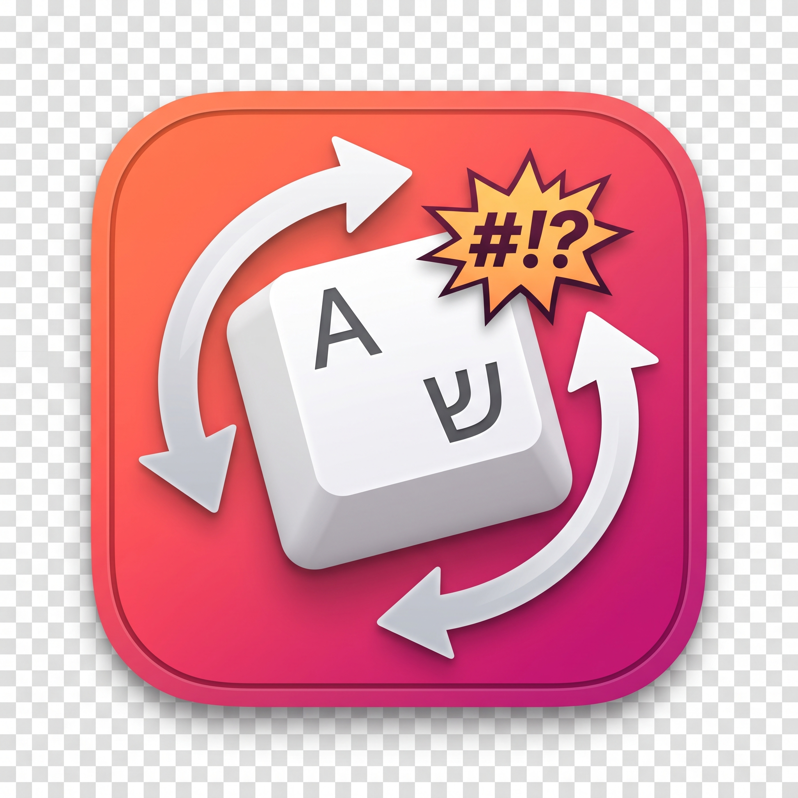
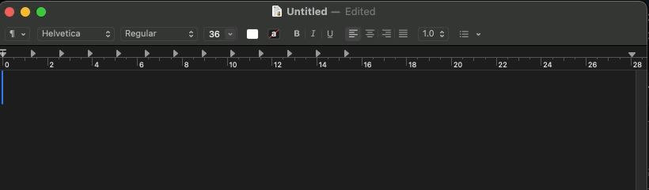

  

<h1 align="center">Shift Happens</h1>

  Typed in the wrong keyboard language? Press one hotkey and it is fixed. 
  Hebrew ↔ English, for Mac and Windows. Free and open source. 
  <a href="#בעברית">בעברית</a>

  

**Contents:** [What it does](#what-it-does) · [Download](#download) · [Mac](#mac) · [Windows](#windows) ·
[Using it](#using-it) · [Privacy and security](#privacy-and-security) · [Updating](#updating) ·
[Questions](#questions) · [Feedback](#feedback) · [בעברית](#בעברית) ·
[License and development](#license-and-development)

## What it does

- **Typed on the wrong keyboard?** `akuo` becomes `שלום`, `יקךךם` becomes `hello`, and your keyboard
  switches to the right language.
- **Right keyboard, typo?** `teh` becomes `the`, using your computer's own spell checker.
- **Nothing selected?** It fixes the word just before the cursor. Select a whole sentence to fix all of it.
- **Mixed text** (`I love איןמעד`) only changes the words that need it.
- Undo with `⌘Z` / `Ctrl+Z`, like any edit.

| | Mac | Windows |
|---|---|---|
| Hotkey | `⌃⇧Space` (Control+Shift+Space) | `Ctrl+Shift+Space` |
| Lives in | the menu bar | the tray, next to the clock |
| Needs | macOS 13 or newer, Apple Silicon or Intel | Windows 10 or 11 (64-bit) |

Both need an English and a Hebrew keyboard added in the system settings. The hotkey can be changed in
**Settings…**.

## Download

**[Download the latest version](https://github.com/Elaad-Adar/shift-happens/releases/latest)**: the file
ending in `-mac.zip` or `-windows.zip`.

Shift Happens is a free hobby project and is **not code-signed** (signing costs money every year), so
your computer will warn you the first time. That is expected; here is exactly what to click.

### Mac

1. Double-click the downloaded zip, then drag **Shift Happens** into your **Applications** folder.
2. Open it. macOS says *"Apple could not verify 'Shift Happens'…"*: click **Done**.
3. Open **System Settings → Privacy & Security**, scroll down, and click **Open Anyway** next to
   Shift Happens. Confirm. (On macOS 13–14 you can instead right-click the app → **Open** → **Open**.)
4. Shift Happens asks for **Accessibility** access (needed to copy and paste for you): click
   **Open System Settings** and turn **Shift Happens** on.
5. Quit Shift Happens from its menu-bar icon and open it again. Done.

### Windows

1. Right-click the downloaded zip → **Extract All**. Don't run it from inside the zip.
2. In the extracted folder, run **ShiftHappens.exe**.
3. If Windows says *"Windows protected your PC"*: click **More info → Run anyway**.
4. The icon appears next to the clock. Right-click it → **Settings…** → tick **Start with Windows**.

PCs with **Smart App Control** turned on (some new Windows 11 PCs) block unsigned apps completely, with
no "Run anyway"; Shift Happens cannot run there.

## Using it

- Select text and press the hotkey. Or don't select anything: it fixes the word before the cursor.
- **Settings…** (from the menu-bar or tray icon): change the hotkey, add an optional "always swap" hotkey,
  turn off "fix the word before the cursor", keyboard switching, start at login, update checks.
- **Check for Updates…**, **Report a Problem…** and **Suggest an Idea…** are in the same menu.

## Privacy and security

An app that asks for Accessibility and touches your clipboard deserves a straight answer:

- It reads text **only when you press the hotkey**: the selection, or the word before the cursor.
- It **never records your typing**. There is no keyboard hook and no Input Monitoring permission.
- It puts your clipboard back after each conversion.
- Its only network call is once a day to GitHub's public "latest release" address, to tell you about
  updates (you can turn this off). No analytics, no account, nothing about you is sent.
- The whole app is in this repository, and every download is built by GitHub Actions from the tagged
  code. Each release lists the SHA-256 checksums of both files.

## Updating

When a new version is out, the menu shows **Update to X.Y.Z…**. It opens the download page; install the
new version over the old one (your settings are kept).

- **Mac:** quit Shift Happens, drag the new one into Applications and choose **Replace**. macOS treats
  every new version as a new app, so in **System Settings → Privacy & Security → Accessibility**, select
  the old **Shift Happens** entry, click **−**, then open the app and allow it again.
- **Windows:** right-click the tray icon → **Quit**, extract the new zip over the old `ShiftHappens.exe`,
  and start it.

## Questions

- **Which apps does it work in?** Anywhere you can select and paste text: WhatsApp, Word, Chrome, Mail,
  Notes, VS Code and so on. Not in terminals, password fields or remote desktops.
- **Other languages?** Hebrew and English only for now. More languages are planned in
  [#9](https://github.com/Elaad-Adar/shift-happens/issues/9).
- **Something went wrong?** `⌘Z` / `Ctrl+Z` undoes it.
- **The hotkey does nothing?** Another app may own it; Shift Happens says so and lets you pick another
  in Settings. On the Mac, check that Accessibility is on for it.

Known limits: in mixed Hebrew/English text, words of 1–3 letters can be read the wrong way; editors that
copy the whole line when nothing is selected (JetBrains IDEs) need the word selected by hand; clipboard
managers see the text for a moment while it is converted.

## Feedback

In the app's menu: **Report a Problem…** or **Suggest an Idea…**. It opens a short form here on GitHub
(Hebrew or English), with the app version and your system filled in. A free GitHub account is needed.

## בעברית

**Shift Happens** מתקנת טקסט שנכתב בשפת מקלדת לא נכונה: `akuo` הופך ל־`שלום`, `יקךךם` הופך ל־`hello`,
והמקלדת עוברת לשפה הנכונה לבד. אם השפה נכונה, היא מתקנת שגיאות כתיב (`teh` ← `the`).
בלי לסמן כלום היא מתקנת את המילה שלפני הסמן; כדי לתקן משפט שלם, מסמנים אותו.

- **קיצור:** ב־Mac ‏`⌃⇧Space`, ב־Windows ‏`Ctrl+Shift+Space`. אפשר לשנות בהגדרות.
- **הורדה:** [הגרסה האחרונה](https://github.com/Elaad-Adar/shift-happens/releases/latest), הקובץ שנגמר
  ב־`-mac.zip` או ב־`-windows.zip`.
- **אזהרה בהתקנה:** האפליקציה חינמית ולא חתומה, ולכן המחשב מזהיר בפעם הראשונה.
  - ב־Mac: הגדרות מערכת ← פרטיות ואבטחה ← **Open Anyway**, ואז לאשר גישת נגישות (Accessibility).
  - ב־Windows: **More info ← Run anyway**.
  - מחשבים שמופעלת בהם "בקרת אפליקציות חכמה" (Smart App Control) חוסמים אותה לגמרי.
- **פרטיות:** האפליקציה קוראת טקסט רק כשלוחצים על הקיצור, לא מקליטה הקלדה, ומחזירה את הלוח (clipboard) למצבו.
  החיבור היחיד לאינטרנט הוא בדיקת עדכונים פעם ביום מול GitHub (אפשר לכבות).
- **משוב:** בתפריט, **Report a Problem…** או **Suggest an Idea…** (אפשר לכתוב בעברית).

## License and development

MIT license, see [LICENSE](LICENSE). Made by Elaad Adar. Changes per version are in
[CHANGELOG.md](CHANGELOG.md); building, testing and releasing are in
[docs/DEVELOPING.md](docs/DEVELOPING.md).
